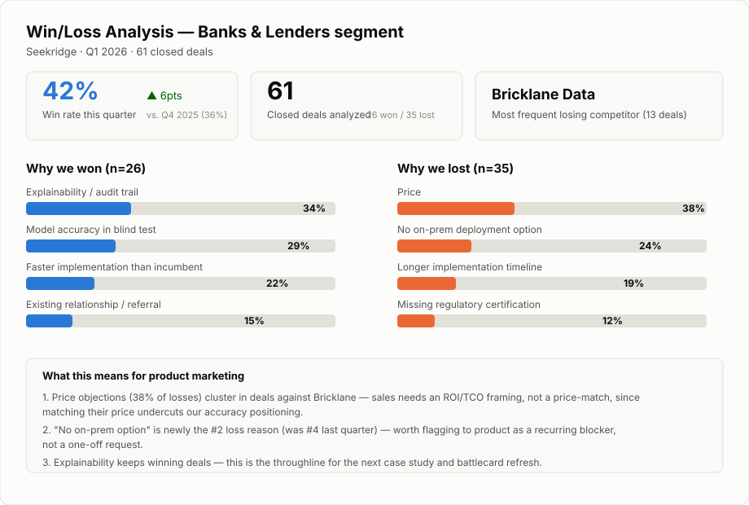

# Win/Loss Analysis

## The problem

Most win/loss "analysis" is a CRM close-reason dropdown nobody trusts, because reps pick whatever's fastest to log. The real reasons a deal was won or lost usually live in call notes, the final email exchange, and the rep's memory — and by the time someone tries to synthesize it quarterly, it's guesswork.

## The approach

Two related outputs, for two different needs:

1. **A quarterly infographic** — takes in raw deal notes (CRM close reasons, rep summaries, call transcript excerpts) across a batch of closed deals, classifies and quantifies the real reasons behind wins and losses, and renders it as one page an exec will actually look at. Opinionated on purpose: it always ends in 2-3 concrete next actions, not just a breakdown of percentages.
2. **A deep-dive analysis** — the same underlying discipline (classify from what actually happened, not the logged shorthand) applied to a full structured CRM export, call analysis and buyer interviews instead of pasted notes, covering five components: buyer demographics, decision drivers, competitor data, product feedback, and sales process insights. Built to answer questions the quarterly infographic isn't structured to hold, like whether response time predicts outcome, or whether the deals we lose skew larger than the ones we win.

## Files — quarterly infographic

- [`skill.md`](./skill.md) — the Claude Skill definition
- [`gpt.md`](./gpt.md) — ChatGPT custom GPT version
- [`win-loss-infographic.svg`](./win-loss-infographic.svg) — sample output, Q1 2026 data for Seekridge's retail-bank segment ([view live ↗](https://tajnelakos.github.io/akos-tajnel-claude-assets/knowledge-base/win-loss-analysis/win-loss-infographic.svg))

## Buyer interviews

CRM fields capture what reps think happened. Win/loss interviews tell you what buyers actually experienced. Product marketing interviews the decision-maker within two to four weeks of the close, for wins and losses alike (15–20 interviews a quarter, from a pipeline of 50–60 invited deals), and compares the buyer's reason with the one the rep logged. In the sample, rep and buyer fully agreed in only 2 of 8 deals.

- [`interview-guide.md`](./interview-guide.md) — who runs it, which deals, timing, consent, the twelve open questions and the write-up fields
- [`buyer-interviews.md`](./buyer-interviews.md) — eight fictional interview summaries, joined to the CRM export by Opportunity ID

Every finding goes to one of four places: battlecards, the product roadmap, sales training, or positioning.

The CRO or Head of Sales owns the discipline. If sales leadership treats win/loss as optional, reps stop logging real reasons and handing over buyer contacts, and the program stalls.

## Files — deep-dive analysis

- [`skill.md`](./skill.md)'s "Deep-dive mode" section — the same skill file, extended for this mode
- [`win-loss-crm-export.csv`](./win-loss-crm-export.csv) — 100 fictional closed opportunities, trailing 12 months (Oct 2025–Sep 2026): deal size, sales cycle, lead source, assigned rep, competitor faced, decision driver, product feedback, demo quality, response time. Fifteen of these records are the same accounts documented in [`sales-call-analysis`](../sales-call-analysis), so the qualitative "how the call went" and the quantitative "what closed" are the same underlying deals, not two disconnected data sets.
- [`win-loss-detailed-analysis.html`](./win-loss-detailed-analysis.html) — the full analysis built from that export ([view live ↗](https://tajnelakos.github.io/akos-tajnel-claude-assets/knowledge-base/win-loss-analysis/win-loss-detailed-analysis.html))

A note on file format: this is a CSV, not a true `.xlsx`/`.xls` binary — this environment doesn't have Python or LibreOffice available to build one properly, and a hand-authored binary spreadsheet file is more likely to arrive corrupted than a clean CSV, which Excel, Sheets, and Salesforce itself all read and write natively anyway.

## Current limitations

The infographic mode still takes pasted deal notes directly rather than a live CRM feed. Interviews are a sample of eight, so the rep-vs-buyer gap is a strong hint rather than a measured rate. The deep-dive mode is currently a one-time pass against a fixed export rather than something re-run incrementally as new deals close — running it as a rolling trailing-12-months view that updates each quarter, rather than a fixed snapshot, is the natural next step.
