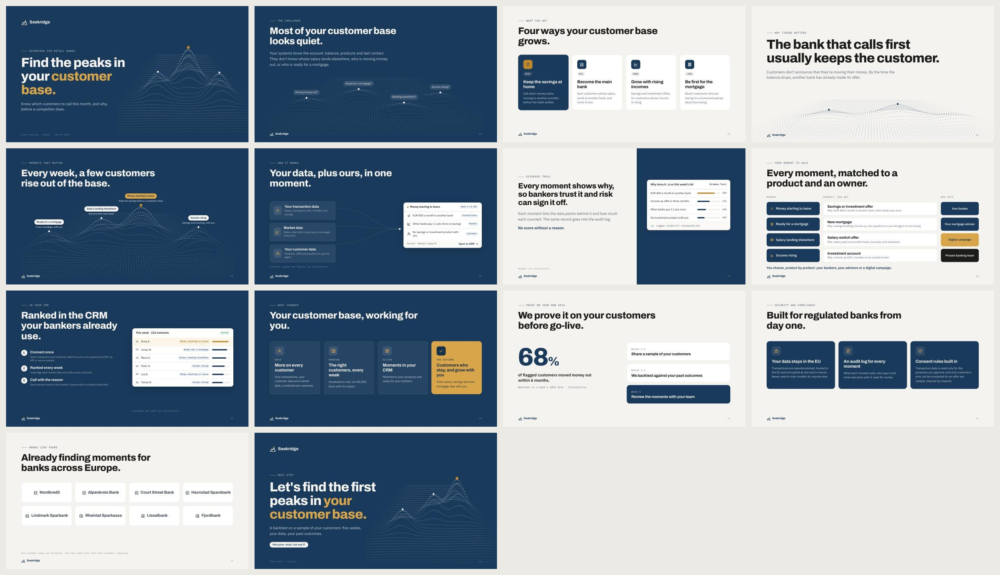

# Sample output: a built deck

The rendered deck: [`deck-retail-banks.html`](./deck-retail-banks.html) ([view live ↗](https://tajnelakos.github.io/akos-tajnel-claude-assets/sales-tools/sales-deck-builder/deck-retail-banks.html)) · PDF: [`deck-retail-banks.pdf`](./deck-retail-banks.pdf)



---

## Input

> Deal context: first meeting with a regional bank's Head of Retail Banking. The bank looks like the main bank for many customers whose salaries, savings and investments quietly sit elsewhere, and finds out when the balance is gone. No known competitor in the deal yet. Build the deck.

## Stage 1 output: the outline

```
## Deck Outline — Regional bank, first meeting with Head of Retail Banking
Persona: Head of Retail Banking (growth buyer) · Stage: First substantive meeting

1. Find the peaks in your customer base.   (L1 Cover)
   Purpose: Open on their customers and the growth they hide, not on Seekridge.
   Key point: Know which customers to call this month, and why, before a competitor does.

2. Most of your customer base looks quiet.   (L2 Quiet base)
   Purpose: Name the problem in their terms: their systems know the account, not the customer's financial life.
   Key point: The opportunities are already in the transactions; nobody can see which customers are moving.

3. Four ways your customer base grows.   (L3 Four cards)
   Purpose: The promise before the mechanism. This persona buys growth levers.
   Key point: Become the main bank, keep the savings, win the mortgage held elsewhere, be first when a customer is ready for more.

4. The bank that calls first usually keeps the customer.   (L4 Statement)
   Purpose: Make timing the stake, then ask how they learn today that money is leaving.
   Key point: Customers don't announce that they're moving their money.

5. Every week, a few customers rise out of the base.   (L5 Moments on the ridge)
   Purpose: The hero visual: the same customer base, now with four moments, each paired with the conversation it opens.
   Key point: Each moment is a reason to call, with the evidence attached.

6. Your data, plus ours, in one moment.   (L6 Data layers)
   Purpose: How it works, in one picture: transaction, customer and market data combine into one moment.
   Key point: One point from each layer makes a call worth making.

7. Every moment shows why, so bankers trust it and risk can sign it off.   (L7 Split with product)
   Purpose: The differentiator, shown in Evidence Trail, framed as banker adoption for this buyer.
   Key point: No score without a reason.

8. Every moment, matched to a product and an owner.   (L8 Moment → product → owner)
   Purpose: Connect moments to revenue and to their choice of channel.
   Key point: A banker, a mortgage advisor or a digital campaign, product by product.

9. Ranked in the CRM your bankers already use.   (L9 Steps and product)
   Purpose: Pre-empt the integration-effort concern this persona carries.
   Key point: Nothing new for bankers to learn.

10. Your customer base, working for you.   (L10 Benefits with outcome)
    Purpose: Sum up as three steps and one outcome.
    Key point: Their salary, savings and next mortgage stay with you.

11. We prove it on your customers before go-live.   (L11 Figure and plan)
    Purpose: One figure, honestly sourced, then the way to prove it on their own data.
    Key point: The only figure that should convince them is a backtest on their customers.

12. Built for regulated banks from day one.   (L12 Three trust cards)
    Purpose: Keep risk and IT objections from stalling the deal later; short for this buyer.
    Key point: Data stays in the EU, every moment is logged, consent rules are built in.

13. Already finding moments for banks across Europe.   (L13 Logo wall)
    Purpose: Social proof from banks like them.
    Key point: Name the two closest to their market.

14. Let's find the first peaks in your customer base.   (L14 Close)
    Purpose: A specific next step, agreed in the room.
    Key point: A five-week backtest on a sample of their customers. Retail, risk and IT join.

Appendix: divider, ranked statement (for a numbers-first room), moments on the paper ground, moments forming, three layers into one moment.
```

## Stage 2 output: the slides

Built from the [slide kit](./slide-kit/layouts.md): 14 main slides and 5 in the appendix, each with speaker notes.

What this deck shows about the kit:
- **The ridge carries the story.** Slide 2 shows the customer base as quiet, slide 5 the same base with moments rising, and appendix slide 18 the moments still forming. It's one illustration, read three ways.
- **The labels have two layers.** The pill says what's happening in the customer's life; the line under it says the conversation it opens for the bank.
- **One gold element per slide.** The urgent moment, the first lever, the digital-campaign owner, the outcome card.
- **Placeholders the rep fills in:** `[Bank]` and `[Month 2026]` on the cover, `[Rep name] · [email]` on the close.

Compare with [`sample-deck-outline.md`](./sample-deck-outline.md): same product, a Head of Model Risk in the room, and a different order. That deck leads with audit exposure and explainability instead of growth levers.
